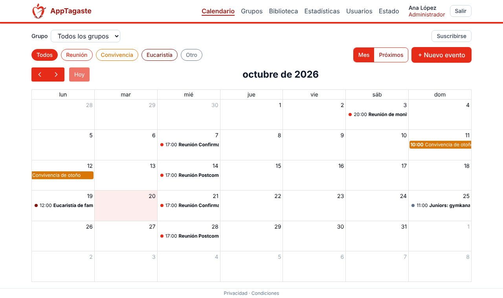
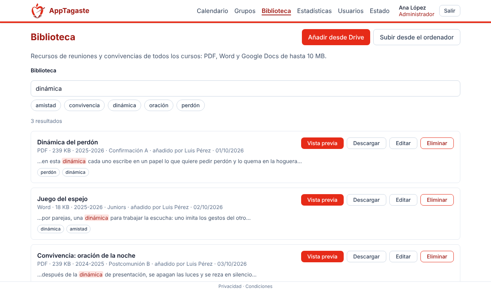
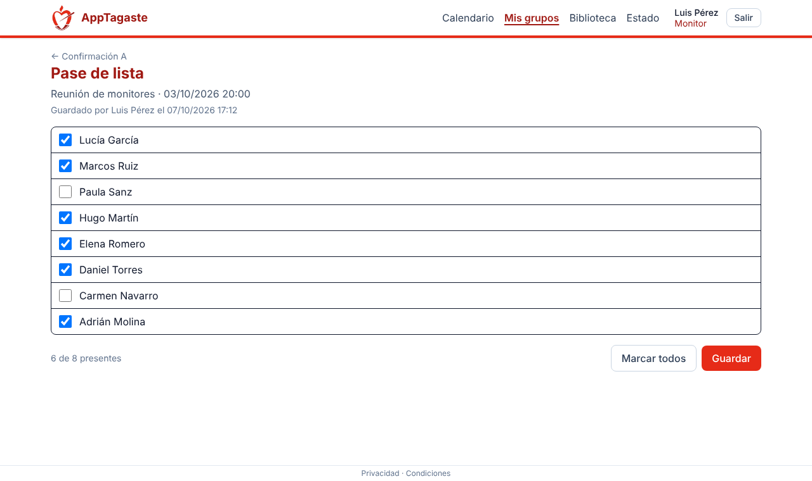
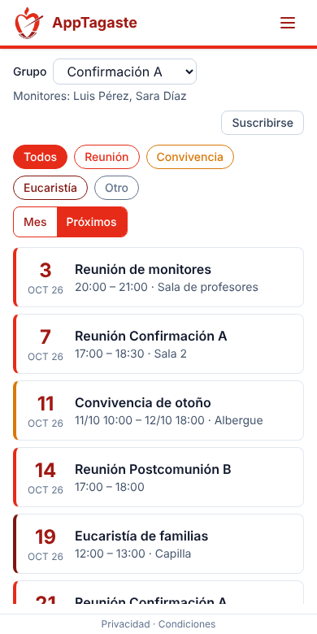
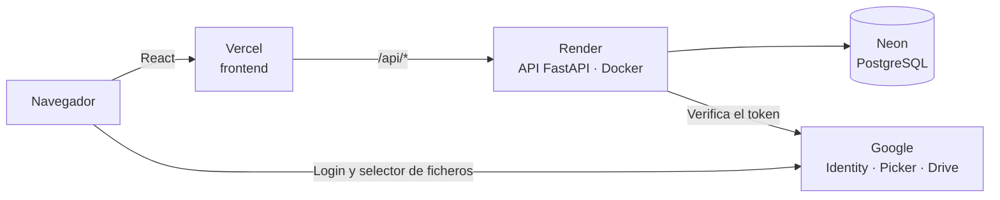

# AppTagaste

[](https://github.com/IgnacioSZ1904/AppTagaste/actions/workflows/ci.yml)
[](https://app-tagaste.vercel.app/)
[](LICENSE)

Aplicación web para organizar la catequesis de un colegio: calendario de reuniones y convivencias, grupos con su pase de lista y una biblioteca de recursos con buscador dentro de los documentos.

**[Probar la app →](https://app-tagaste.vercel.app/)** · Se entra con cualquier cuenta de Google. La API está en un plan gratuito que se duerme: la primera visita tarda alrededor de un minuto.

*[English version below](#english)*



| Biblioteca con buscador | Pase de lista | Móvil |
|---|---|---|
|  |  |  |

<sub>Capturas con datos inventados.</sub>

## Qué hace

| Rol | Puede |
|-----|-------|
| **Usuario** | Ver el calendario por grupo y suscribirse a él desde el móvil (iCal) |
| **Monitor** | Ver los niños de sus grupos, pasar lista y usar la biblioteca |
| **Coordinador** | Crear y editar eventos de uno o varios grupos y ver estadísticas de asistencia (CSV) |
| **Admin** | Todo lo anterior, más gestionar usuarios y roles, grupos y sus responsables |

- **Biblioteca:** se añaden documentos desde Google Drive (o desde el ordenador), se ordenan por curso y grupo con etiquetas, y se buscan por su contenido, con el fragmento encontrado resaltado. Vista previa de PDF y Word.
- **Privacidad:** los niños no tienen cuenta; solo se guarda su nombre, que ven únicamente los responsables de su grupo. Páginas de [privacidad](https://app-tagaste.vercel.app/privacidad) y [condiciones](https://app-tagaste.vercel.app/condiciones).

## Stack

| | |
|---|---|
| **Backend** | Python 3.12, FastAPI, SQLAlchemy 2, Alembic, Pydantic |
| **Base de datos** | PostgreSQL 16 (búsqueda de texto completo en español) |
| **Frontend** | React 19, TypeScript, Vite, Tailwind CSS 4, TanStack Query, React Router |
| **Calidad** | pytest, ruff, Vitest, Testing Library, oxlint, Prettier, GitHub Actions |
| **Infra** | Docker Compose en local; Vercel, Render y Neon en producción (coste 0 €) |

## Arquitectura



El backend sigue capas `api → services → models`: los endpoints solo validan y traducen a HTTP, y la lógica vive en los servicios.

## Decisiones técnicas

Cada decisión está explicada con sus alternativas en un [ADR](docs/adr/README.md).

- **Login solo con Google y JWT propio:** sin contraseñas que guardar; el rol se comprueba en cada petición ([0002](docs/adr/0002-autenticacion-google-jwt.md)).
- **Drive con el permiso mínimo:** el usuario elige los ficheros con el selector de Google (`drive.file`) y el token de Drive nunca llega al servidor ([0007](docs/adr/0007-drive-file-y-selector.md)).
- **Buscador sin servicios extra:** `tsvector` de PostgreSQL en español, sin tildes y con relevancia, en lugar de Elasticsearch ([0008](docs/adr/0008-buscador-postgresql.md)).
- **Copia de los documentos en la BD:** sobreviven aunque se borren de Drive y el disco de Render no se pierde en cada despliegue ([0006](docs/adr/0006-ficheros-en-la-base-de-datos.md)).
- **Despliegue gratuito** con Vercel, Render y Neon, y despliegue automático desde `master` ([0004](docs/adr/0004-despliegue-gratuito.md)).

## Calidad

- **190 tests de backend** contra PostgreSQL real (cada test en una transacción que se deshace) y **79 de frontend**.
- **CI** en cada push y PR: lint, tests y build.
- **Errores homogéneos:** `{"detail": "…"}` en español en toda la API, y los 500 con un `request_id` que se busca en los logs (una línea por petición con `X-Request-ID`).
- **API documentada** en OpenAPI, con descripción, grupos y errores de cada ruta: [`/docs`](https://apptagaste-api.onrender.com/docs).

## Cómo está hecho

Cada funcionalidad tiene su carpeta en [`docs/features`](docs/features) con **análisis → planificación → tareas → devlog → lecciones aprendidas**, y el orden de todo está en el [BACKLOG](docs/BACKLOG.md). Ejemplo: [16 · buscador de texto completo](docs/features/16-buscador-texto-completo). Cada feature se integra en `develop` con una PR, y `master` es producción.

## Arranque rápido

Necesitas Docker y Node.js 24.

```bash
cp .env.example .env                 # y rellena GOOGLE_CLIENT_ID
docker compose up --build            # BD + API en http://localhost:8000
cd frontend && cp .env.example .env  # y rellena VITE_GOOGLE_CLIENT_ID
npm install && npm run dev           # http://localhost:5173
```

Configuración de Google, primer admin, migraciones, despliegue y referencia de la API: **[guía técnica](docs/guia.md)**.

## Licencia

[MIT](LICENSE) © 2026 Ignacio Segovia Zurita

---

<a id="english"></a>

## English

**AppTagaste** is a web app to run the catechesis groups of a school: a calendar of meetings and retreats, groups with attendance tracking, and a resource library with full-text search inside the documents. **[Live demo](https://app-tagaste.vercel.app/)** (sign in with any Google account; the free API tier sleeps, so the first visit takes about a minute).

**Features**
- Four roles: *usuario* (calendar and iCal subscription), *monitor* (their groups' children, attendance, library), *coordinador* (events and attendance statistics with CSV export), *admin* (everything, plus users, roles and groups).
- Library: add files from Google Drive or from your computer, organise them by school year, group and tags, and search their content (Spanish full-text search with highlighted snippets). PDF and Word preview.
- Privacy by design: children have no accounts; only their name is stored, visible to their group's leaders only.

**Stack:** Python 3.12, FastAPI, SQLAlchemy 2, Alembic, PostgreSQL 16 · React 19, TypeScript, Vite, Tailwind CSS 4, TanStack Query · pytest, ruff, Vitest, oxlint, GitHub Actions · Docker; deployed for free on Vercel, Render and Neon.

**Highlights**
- Google sign-in with the app's own JWT; roles checked on every request.
- Google Picker with the minimal `drive.file` scope; the Drive token never reaches the server.
- PostgreSQL full-text search (Spanish, accent-insensitive, ranked) instead of a separate search engine.
- Consistent JSON errors, per-request logs with `X-Request-ID`, documented OpenAPI.
- 190 backend tests against a real PostgreSQL database and 79 frontend tests, run in CI.
- Every decision is recorded in an [ADR](docs/adr/README.md), and every feature has its analysis, plan, tasks, devlog and lessons learned in [`docs/features`](docs/features).

**Run locally:** see the commands in [Arranque rápido](#arranque-rápido) and the [technical guide](docs/guia.md) (in Spanish).

**License:** [MIT](LICENSE) © 2026 Ignacio Segovia Zurita
